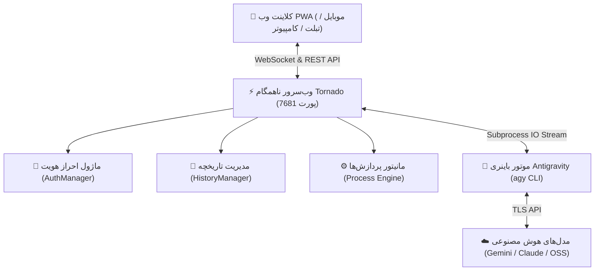

# 📘 مستندات جامع و راهنمای ساختار سیستم AntiMobile Pro

این سند راهنمای کامل معماری، نحوه عملکرد، امنیت و ابزارهای سیستم **AntiMobile Pro** است.

---

## ۱. نمای کلی سیستم (System Architecture)

پروژه **AntiMobile Pro** یک وب‌اپلیکیشن پیشرو (PWA) با معماری توزیع‌شده و چندسکویی است که به عنوان کلاینت پیشرفته خط فرمان **Google Antigravity (AGY)** طراحی شده است.



---

## ۲. لایه‌های فنی سیستم

### ۲.۱. لایه سرور و ناهمگام (Backend Engine - Python Tornado)
- **فایل:** `server.py`
- **وب‌سوکت دوطرفه (`/ws`):** وظیفه ارسال لحظه‌ای توکن‌های متن، استخراج زنده فرایند استدلال (Thinking Process) و رویدادهای ابزارها (`run_command`, `read_file`, `write_file`) را به فرانت‌اند بر عهده دارد.
- **ایزوله‌سازی نشست‌ها:** هر کاربر پس از احراز هویت به گفتگوی فعال خود متصل شده و پردازش‌ها به صورت ایزوله اجرا می‌شوند.
- **ردیاب زنده پینگ و سلامت:** اندپوینت `/api/health` وضعیت اینترنت، پردازش‌های پس‌زمینه و پاسخگویی سرور را پایش می‌کند.

### ۲.۲. لایه امنیت و احراز هویت (Authentication & Security)
- **رمزنگاری هش:** استفاده از ترکیب `SHA-256` با `Salt` ۱۶ بایتی تصادفی و غیرقابل بازگشت.
- **مدیریت توکن:** تولید توکن‌های ۳۲ بایتی امن با کتابخانه `secrets`.
- **نگهداری نشست:** پشتیبانی از نشست‌های ۳۰ روزه پایدار با کوکی‌های امن `HttpOnly` با ویژگی `SameSite=Lax` به همراه پشتیبانی از هدرهای استاندارد `Authorization: Bearer <token>`.
- **مشخصات ورود پیش‌فرض:**
  - **نام کاربری:** `admin`
  - **رمز عبور:** `antigravity`
- **شخصی‌سازی سریع:** امکان تنظیم از طریق متغیرهای محیطی:
  ```bash
  export ANTI_USERNAME="myuser"
  export ANTI_PASSWORD="SuperSecretPassword123"
  ./start.sh
  ```

### ۲.۳. لایه فرانت‌اند و رابط کاربری (Frontend UI / PWA)
- **طراحی OLED Dark:** رنگ‌بندی فوق‌العاده تاریک با کنتراست بالا بهینه‌شده برای نمایشگرهای AMOLED با مصرف باتری بسیار کم.
- **استقلال کامل از اینترنت (100% Offline Asset Ready):** تمامی فونت‌ها (وزیرمتن و جتبریز مونو)، کتابخانه تفکیک مارک‌داون (`marked.min.js`) و موتور هایلایت کد (`highlight.min.js`) به صورت لوکال در پروژه ذخیره شده‌اند و نیازی به CDN خارجی ندارند.
- **انطباق‌پذیری کامل:** واکنش‌گرا برای گوشی‌های لمسی، تبلت‌ها و پنجره‌های مرورگر دسکتاپ.

---

## ۳. دستورات خط فرمان و اسکریپت‌های مدیریت

| نام اسکریپت | وظیفه و توضیحات |
| :--- | :--- |
| `start.sh` | راه‌اندازی سرور در پس‌زمینه، اختصاص خودکار پورت، استخراج IP شبکه و باز کردن مرورگر |
| `stop.sh` | متوقف‌سازی کامل پروسه‌های پایتون و آزادسازی پورت ۷۶۸۱ |
| `install.sh` | نصب‌کننده هوشمند چندسکویی (شناسایی خودکار ترموکس، مک، دبیان، آرچ و ساخت شورت‌کات‌ها) |
| `push_to_github.sh` | ممیزی حریم خصوصی و عدم نشت فایل‌های حساس، بررسی کلیدهای SSH و ارسال خودکار به گیت‌هاب |
| `agy-app` | میانبر سریع اجرای پرتابل اپلیکیشن در محیط ترمینال |

---

## ۴. دستورات اسلش تعبیه‌شده در برنامه (Slash Commands)

در نوار ورودی با فشردن کاراکتر `/` منوی شناور دستورات زیر ظاهر می‌شود:

- `/goal` : اجرای خودکار بدون توقف تسک‌های عمیق تا رسیدن به هدف کامل.
- `/plan` : برنامه‌ریزی و ارائه استراتژی گام‌به‌گام پیش از اجرای تغییرات.
- `/boost` : تفکر چندبعدی، عمیق و بررسی مسئله از زوایای مختلف.
- `/compact` : فشرده‌سازی تاریخچه چت برای آزادسازی حافظه کانتکست.
- `/schedule` : زمان‌بندی و تنظیم کارهای دوره‌ای.
- `/browser` : مرور و اتوماسیون صفحات وب.
- `/model` : نمایش یا تغییر سریع مدل زبانی فعال.
- `/effort` : تغییر سطح تلاش فکری (`low`, `medium`, `high`, `max`).
- `/mode` : تغییر مود کاری ایجنت (`auto`, `plan`, `request-review`).
- `/restart` : متوقف کردن پروسه‌های گیر کرده و راه‌اندازی مجدد نشست.
- `/clear` : پاک کردن تاریخچه گفتگوی فعال.
- `/help` : مشاهده راهنمای تعاملی.

---

## ۵. راهنمای شبکه و دسترسی از راه دور

اگر سرور را روی گوشی اندروید (ترموکس) یا رایانه اجرا کرده‌اید و می‌خواهید از دستگاه‌های دیگر (مانند لپ‌تاپ یا گوشی دیگر در همان وای‌فای) به آن متصل شوید:
1. دستور `./start.sh` را اجرا کنید.
2. آدرس نمایش‌داده‌شده تحت عنوان `آدرس شبکه (Wi-Fi)` را در مرورگر دستگاه دوم وارد کنید:
   `http://192.168.x.x:7681`
3. با نام کاربری `admin` و رمز `antigravity` وارد شوید.
